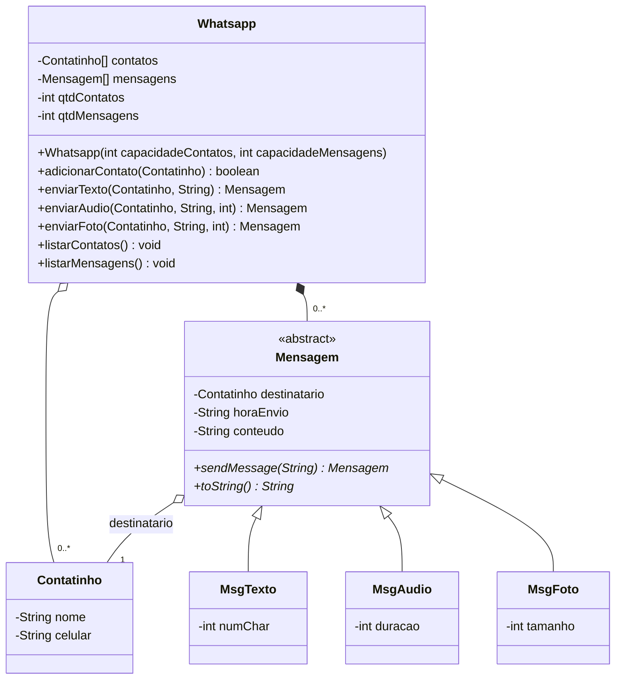

# LP II — Exercícios de POO em Java

Projeto único com os exercícios da disciplina, cada um em seu próprio pacote.

## Estrutura

```
src/main/java/edu/fatec/lp2/
└── exercicio1/
    ├── app/        Main.java (classe executável)
    ├── modelo/     Whatsapp.java, Contatinho.java
    └── mensagens/  Mensagem.java (abstrata), MsgTexto.java, MsgAudio.java, MsgFoto.java
```

## Exercício 1 — Whatsapp

Como executar: abra o projeto na IDE (IntelliJ, Eclipse, NetBeans ou VS Code reconhecem o `pom.xml`) e rode `edu.fatec.lp2.exercicio1.app.Main`.

Pelo terminal, sem Maven:

```bash
javac -d out $(find src -name "*.java")
java -cp out edu.fatec.lp2.exercicio1.app.Main
```

### Requisitos atendidos

- `contatos` e `mensagens` são arrays (`Contatinho[]` e `Mensagem[]`), inicializados no construtor de `Whatsapp`.
- Todos os atributos são `private`.
- `Mensagem` é abstrata e declara `public abstract Mensagem sendMessage(String)`.
- Cada subclasse implementa `sendMessage` e retorna `this` (a própria instância).

### Correções de design em relação ao diagrama

| Diagrama | Implementação | Motivo |
|---|---|---|
| `contatos : Contatinho` | `Contatinho[] contatos` | O Whatsapp guarda vários contatos; o atributo precisa ser uma coleção (array, como pede o enunciado). |
| `mensagens : Mensagem` | `Mensagem[] mensagens` | Mesmo motivo. |
| `toString() : void` | `String toString()` | Em Java, `toString()` sobrescreve o método de `Object` e obrigatoriamente retorna `String`. Com `void` o código nem compila. |
| (não existe) | `sendMessage(String) : Mensagem` | Método abstrato pedido no enunciado. |
| (não existe) | `adicionarContato`, `enviarTexto`, `enviarAudio`, `enviarFoto` | Sem eles não há como preencher os arrays, já que os atributos são privados. Como a relação com `Mensagem` é **composição** (losango preenchido), as mensagens são criadas pelo próprio `Whatsapp`, não recebidas prontas de fora. |
| (não existe) | `qtdContatos`, `qtdMensagens` | Arrays têm tamanho fixo; os contadores indicam quantas posições estão de fato ocupadas. |
| `string` | `String` | Em Java o tipo é `String` (com S maiúsculo). |

Outras decisões:

- **Agregação com `Contatinho`** (losango vazio): o contato é criado fora e só adicionado ao Whatsapp; ele continua existindo independentemente.
- O Whatsapp só aceita mensagens para quem está na lista de contatos.
- `numChar` é calculado automaticamente a partir do texto enviado; `duracao` (segundos) e `tamanho` (KB) são informados no construtor de cada mensagem.
- `horaEnvio` é preenchida no momento do `sendMessage`. A lógica comum do envio fica em `Mensagem.registrarEnvio()` (método `protected`) para não repetir código nas subclasses.

### Diagrama corrigido


