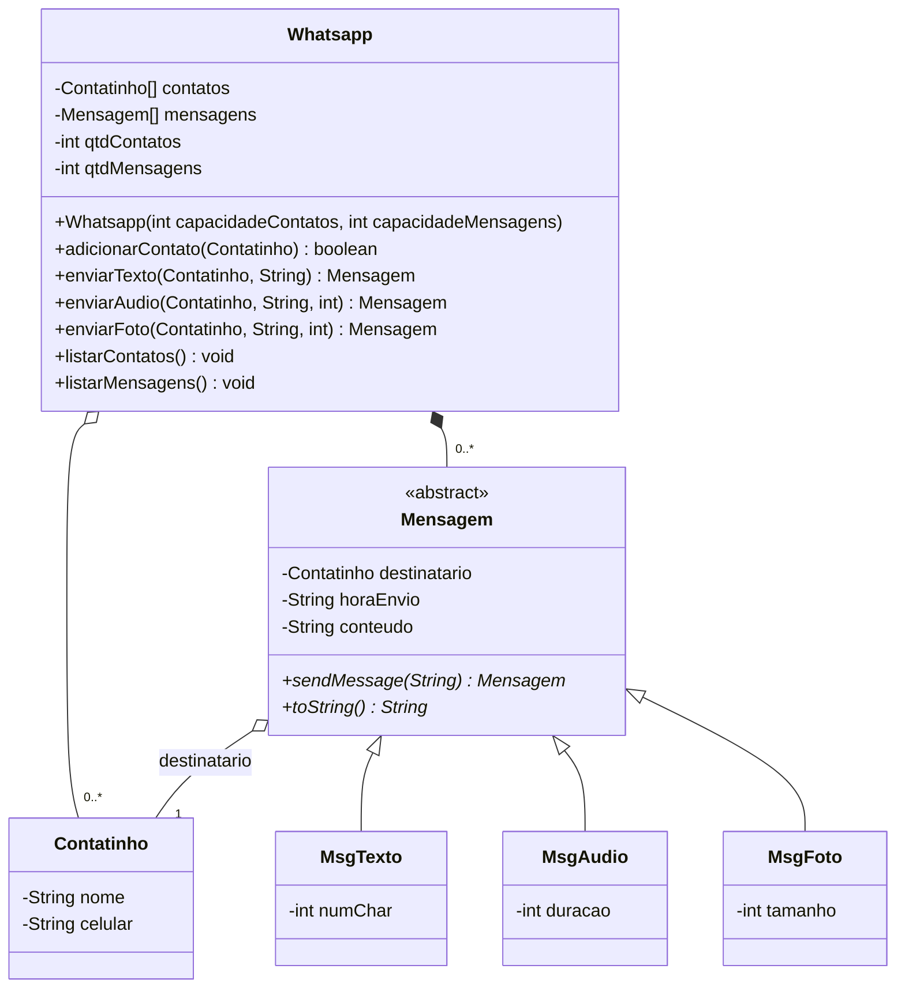
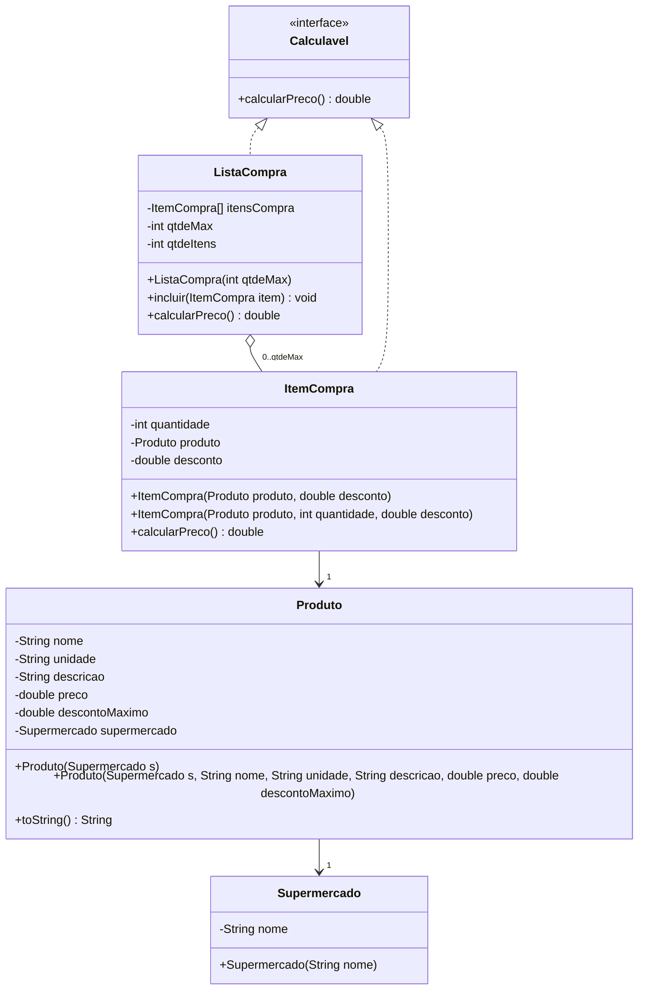

# LP II — Exercícios de POO em Java

Projeto único com os exercícios da disciplina, cada um em seu próprio pacote.

## Estrutura

```
src/main/java/edu/fatec/lp2/
├── exercicio1/
│   ├── app/        Main.java (classe executável)
│   ├── modelo/     Whatsapp.java, Contatinho.java
│   └── mensagens/  Mensagem.java (abstrata), MsgTexto.java, MsgAudio.java, MsgFoto.java
└── exercicio2/
    ├── app/        Main.java (classe executável)
    ├── modelo/     Supermercado.java, Produto.java
    └── compra/     Calculavel.java (interface), ItemCompra.java, ListaCompra.java
```

## Exercício 1 — Whatsapp

Como executar: abra o projeto na IDE (IntelliJ, Eclipse, NetBeans ou VS Code reconhecem o `pom.xml`) e rode `edu.fatec.lp2.exercicio1.app.Main`.

Pelo terminal, sem Maven:

```bash
javac -d out $(find src -name "*.java")
java -cp out edu.fatec.lp2.exercicio1.app.Main
```

### Requisitos atendidos

- `contatos` e `mensagens` são arrays (`Contatinho[]` e `Mensagem[]`), inicializados no construtor de `Whatsapp`.
- Todos os atributos são `private`.
- `Mensagem` é abstrata e declara `public abstract Mensagem sendMessage(String)`.
- Cada subclasse implementa `sendMessage` e retorna `this` (a própria instância).

### Correções de design em relação ao diagrama

| Diagrama | Implementação | Motivo |
|---|---|---|
| `contatos : Contatinho` | `Contatinho[] contatos` | O Whatsapp guarda vários contatos; o atributo precisa ser uma coleção (array, como pede o enunciado). |
| `mensagens : Mensagem` | `Mensagem[] mensagens` | Mesmo motivo. |
| `toString() : void` | `String toString()` | Em Java, `toString()` sobrescreve o método de `Object` e obrigatoriamente retorna `String`. Com `void` o código nem compila. |
| (não existe) | `sendMessage(String) : Mensagem` | Método abstrato pedido no enunciado. |
| (não existe) | `adicionarContato`, `enviarTexto`, `enviarAudio`, `enviarFoto` | Sem eles não há como preencher os arrays, já que os atributos são privados. Como a relação com `Mensagem` é **composição** (losango preenchido), as mensagens são criadas pelo próprio `Whatsapp`, não recebidas prontas de fora. |
| (não existe) | `qtdContatos`, `qtdMensagens` | Arrays têm tamanho fixo; os contadores indicam quantas posições estão de fato ocupadas. |
| `string` | `String` | Em Java o tipo é `String` (com S maiúsculo). |

Outras decisões:

- **Agregação com `Contatinho`** (losango vazio): o contato é criado fora e só adicionado ao Whatsapp; ele continua existindo independentemente.
- O Whatsapp só aceita mensagens para quem está na lista de contatos.
- `numChar` é calculado automaticamente a partir do texto enviado; `duracao` (segundos) e `tamanho` (KB) são informados no construtor de cada mensagem.
- `horaEnvio` é preenchida no momento do `sendMessage`. A lógica comum do envio fica em `Mensagem.registrarEnvio()` (método `protected`) para não repetir código nas subclasses.

### Diagrama corrigido



## Exercício 2 — Domínio de Compras (Seu Astolfo)

Como executar: rode `edu.fatec.lp2.exercicio2.app.Main`.

```bash
javac -d out $(find src -name "*.java")
java -cp out edu.fatec.lp2.exercicio2.app.Main
```

### Como cada necessidade foi atendida

| Necessidade | Onde |
|---|---|
| Supermercado simplificado | `Supermercado` (só `nome`) |
| Produto com atributos próprios e um único comportamento que retorna o nome | `Produto.toString()` retorna `nome` |
| Item com quantidade e desconto entre 0 e `descontoMaximo` | `ItemCompra.setDesconto()` valida a faixa e lança `IllegalArgumentException` se passar |
| Vincular produto e desconto ao item | Construtor `ItemCompra(produto, desconto)` |
| Um único produto por item | Atributo `Produto produto` (não é array), obrigatório (não aceita `null`) |
| Preço do item independente dos demais | `ItemCompra.calcularPreco()` = preço × quantidade × (1 − desconto/100) |
| Lista com quantidade limite | `ListaCompra(qtdeMax)` cria o array com esse tamanho |
| Adicionar itens até o limite | `ListaCompra.incluir()` recusa quando a lista está cheia |
| Preço total da lista | `ListaCompra.calcularPreco()` soma o `calcularPreco()` de cada item |
| Interface comum | `ItemCompra` e `ListaCompra` implementam `Calculavel` |

### Correções de design em relação ao diagrama

| Diagrama | Implementação | Motivo |
|---|---|---|
| Nomes das classes em *itálico* | Classes concretas | Em UML, nome em itálico indica classe **abstrata**, mas todas precisam ser instanciadas (`new Produto(...)`, `new ItemCompra(...)` etc.). Só `Calculavel` é abstrata, e ela é interface. |
| `ItemCompra(produto, desconto)` não recebe quantidade | Mantido (quantidade começa em 1) + novo construtor `ItemCompra(produto, quantidade, desconto)` | O item tem `quantidade`, mas o construtor do diagrama não dá como informá-la. |
| `Produto(s: Supermercado)` | Mantido + construtor completo | Sem o construtor completo, criar um produto exige 5 setters seguidos. |
| `ListaCompra` sem contador | `qtdeItens` | O array tem tamanho fixo; o contador diz quantas posições estão ocupadas e onde entra o próximo item. |
| Getters e setters em todas as classes | `ListaCompra` sem `setItensCompra` e `setQtdeMax`; `getItensCompra()` devolve cópia | Trocar o array ou o limite por fora furaria a regra da quantidade máxima. Itens só entram por `incluir()`. |
| Setters sem regra | Setters validam (`preco ≥ 0`, `0 ≤ descontoMaximo ≤ 100`, `quantidade > 0`, desconto dentro do máximo) | As regras do negócio valeriam só no construtor e poderiam ser burladas pelo setter. |
| Associações sem multiplicidade | `Produto → 1 Supermercado`, `ItemCompra → 1 Produto`, `ListaCompra → 0..qtdeMax ItemCompra` | Deixa explícito o "um único produto por item" e o limite da lista. |

Outras decisões:

- `desconto` e `descontoMaximo` são **percentuais** (10 = 10%).
- Getters e setters foram gerados pela IDE em vez de Lombok, para o projeto rodar sem dependências e para permitir as validações nos setters.
- Valores em `double`, como no diagrama. Num sistema real de dinheiro o ideal seria `BigDecimal`, que não tem erros de arredondamento.

### Diagrama corrigido


